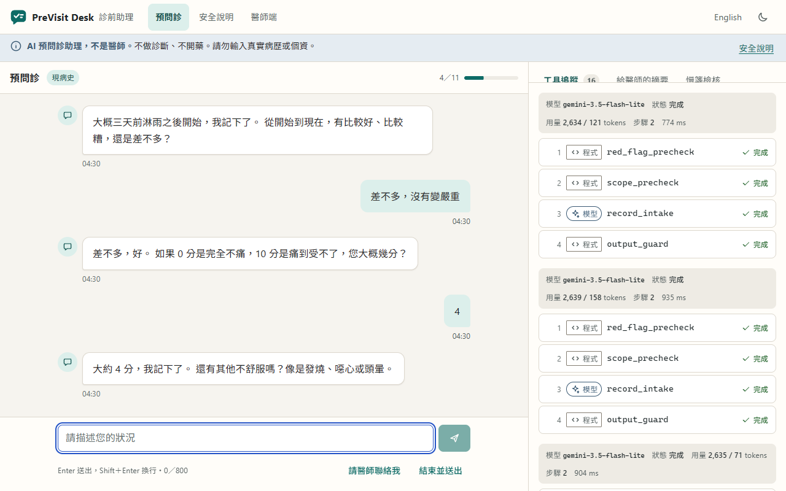
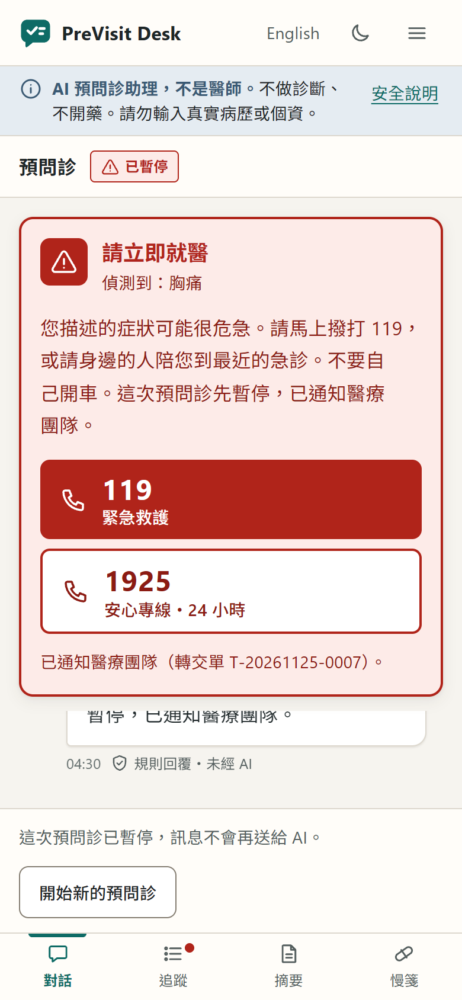
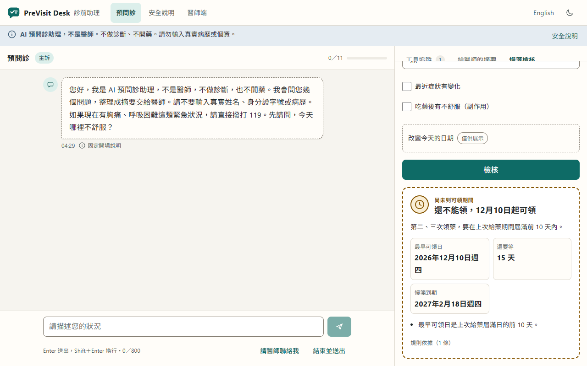
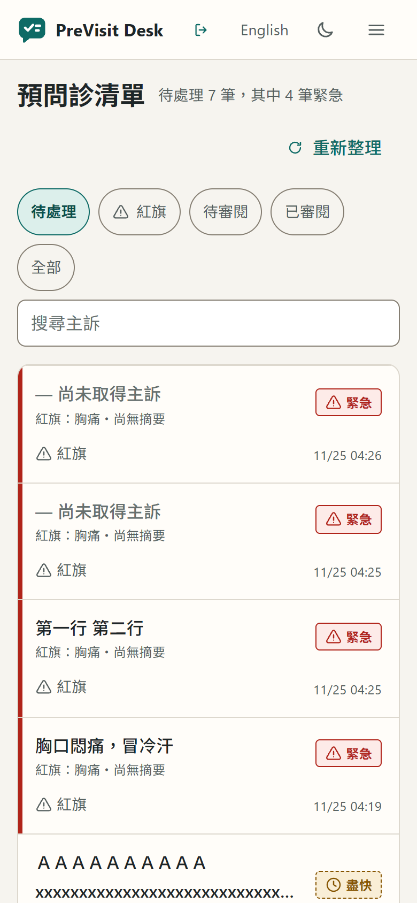
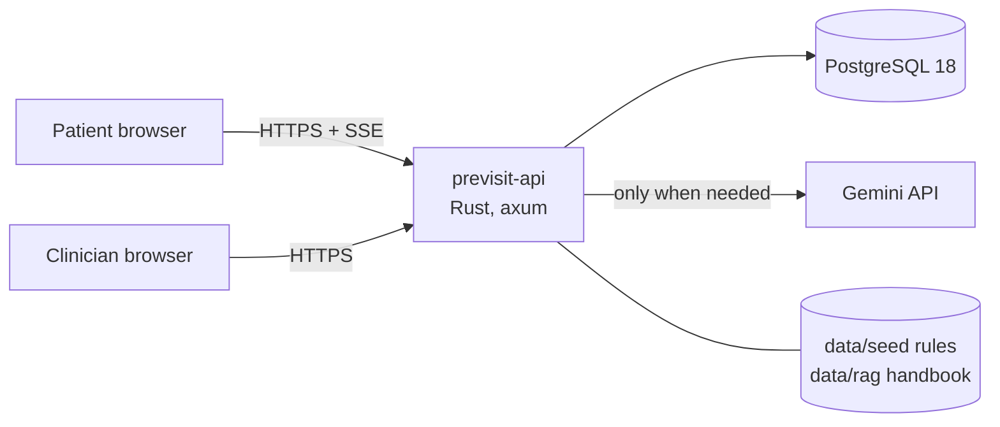

<p align="center">
  
</p>

<p align="center">
  An AI pre-visit intake and chronic-prescription refill checker for Taiwan.<br>
  The AI collects history for the clinician. Anything that has to be certain is decided by code.
</p>

<p align="center">
  <a href="https://previsit.naritaroad.com">Live demo</a> ·
  <a href="https://naritaroad.github.io/previsit-desk/">Project page</a> ·
  <a href="docs/engineering/architecture.md">Architecture</a> ·
  <a href="https://github.com/naritaroad/previsit-desk/issues">Issues</a>
</p>

<p align="center">
  
  
  
  
</p>

**English** | [繁體中文](README.zh-TW.md)

PreVisit Desk talks to a patient before the appointment, in stages, and hands the clinician a one-page summary. A patient on a chronic-disease continuous prescription (慢箋) can also check whether this refill can be collected directly. The assistant does not diagnose, does not prescribe, and does not give doses. It was built as a course project on responsible deployment of a medical chatbot, and it only ever sees fictional patients.

## Why it is built this way

A medical chatbot can be useful for very different jobs: patient education, administration, emotional support, triage, or treatment. Each needs different evidence and carries different responsibility. This project takes on two narrow jobs, **gathering history for a clinician** and **calculating refill rules**, and refuses the rest.

| Use | Position |
| --- | --- |
| Diagnosis, treatment, prescribing | Not done. A request gets a fixed refusal and a handoff ticket to a clinician. |
| Triage | Red-flag rules only. A hit returns fixed 119 / emergency text and never calls the model. |
| Administration | Done: pre-visit summaries and refill date checks. |
| Patient education | Answers only from a handbook of official sources. Every passage carries its source URL and check date. No doses. |
| Emotional support | Not done. Self-harm signals get a fixed pointer to the 1925 hotline and 119. |

## Features

- **Staged intake.** Chief complaint, history of present illness (onset, modifiers, character, location, severity, course, associated symptoms), background (past history, medications, allergies), then a read-back the patient confirms. Code tracks which fields are filled; the model is told only what is missing and asks one or two questions at a time.
- **Red flags before the model.** Chest pain, trouble breathing, one-sided weakness or slurred speech, collapse, vomiting blood or black stool, severe allergy, seizure, and suicidal thoughts are matched by rules in `data/seed/red_flags.csv`. A hit returns fixed text, opens an urgent ticket, and shows a card with tap-to-call 119 and 1925.
- **Refill check in plain Rust.** Four outcomes only: can collect, too early (with the earliest date), needs a revisit, or ask a pharmacist or doctor. Each result lists the rules it applied and their source. Any controlled drug, changed symptoms or side effects always go to a human with a ticket.
- **Clinician queue.** Pending summaries, the full conversation with its tool trace, handoff tickets, and a reviewed mark. Urgent cases come first.
- **Auditable.** Every tool call, red-flag result, model name and token count is stored and shown in the trace panel.
- **Built for a public demo.** Per-client rate limits, a daily model-call cap, personal-data masking before storage and before any model call, and automatic deletion after the retention period.

## Screens

<p>
  
  
</p>
<p>
  
  
</p>

## Safety boundaries

| # | Boundary | Where it is enforced |
| --- | --- | --- |
| 1 | The first message says it is an AI assistant, not a doctor. A banner stays on screen. | Fixed text from `POST /visits`; `web/src/components` banner |
| 2 | Red flags come before the model. A hit never reaches it. | `backend/src/precheck`, rules in `data/seed/red_flags.csv` |
| 3 | No diagnosis, no prescribing, no doses. | System prompt, scope rules (`data/seed/scope_rules.csv`), and an output guard that rewrites or replaces the reply |
| 4 | Refill results are one of four outcomes. Controlled drugs, symptom changes and side effects go to a human. | `backend/src/refill.rs`, numbers in `data/seed/refill_rules.csv` |
| 5 | Everything is auditable. | `tool_calls`, `runs`, `red_flag_events`, `guard_events` tables and the trace panel |
| 6 | Privacy. No name or ID field; identifiers masked; visits deleted after `RETENTION_DAYS`. | `backend/src/pii.rs`, retention sweep |

<!-- EVAL:START -->
Evaluation results are written to `data/eval/results/` by `cargo run -- eval` and summarized here after each run.
<!-- EVAL:END -->

## Architecture



One Rust process serves the API and the built web client. Each patient message runs through PII masking, the red-flag precheck and the scope precheck before any model call; the model loop is bounded and its replies pass an output guard. Details and the message pipeline are in [docs/engineering/architecture.md](docs/engineering/architecture.md); endpoints and events are in [docs/api/contract.md](docs/api/contract.md).

## Quick start

Prerequisites: Docker, Rust 1.99, Node 24.

```bash
cp .env.example .env          # set POSTGRES_PASSWORD, DATABASE_URL and CLINICIAN_PASSWORD
                              # add GEMINI_API_KEY, or set LLM_MODEL=mock to run offline
docker compose up -d db       # PostgreSQL on 127.0.0.1:5433
cd backend && cargo run       # API on BIND_ADDR (default 127.0.0.1:8088)
cd web && npm ci && npm run dev   # client on http://localhost:5173, /api proxied to :8088
```

The clinician pages use the account in `.env` (`CLINICIAN_USERNAME`, default `dr_demo`, and `CLINICIAN_PASSWORD`). Use fictional patients only.

```bash
cd backend && cargo fmt --check && cargo clippy -- -D warnings && cargo test
cd web && npm run build && npm test          # i18n check, type check, build, unit tests
cd backend && cargo run -- eval              # runs data/eval/cases.jsonl against the configured model
powershell -File scripts/e2e-smoke.ps1 -BaseUrl http://127.0.0.1:8088 -ClinicianPassword '<password>'
```

`npm run mock` in `web/` starts a stand-in API on :8088 for working on the client without the backend. To build and deploy the container image, see [DEPLOY.md](DEPLOY.md).

<details>
<summary>Configuration</summary>

Every setting is an environment variable; `.env.example` lists them all.

| Variable | Purpose |
| --- | --- |
| `DATABASE_URL`, `POSTGRES_*` | PostgreSQL connection and the dev container |
| `BIND_ADDR`, `WEB_DIR`, `DATA_DIR` | Listen address, built client folder, data folder |
| `LLM_MODEL`, `LLM_MODEL_FALLBACK`, `LLM_THINKING` | Model names and thinking level; `LLM_MODEL=mock` runs offline |
| `GEMINI_API_KEY` | Backend only; never sent to the browser |
| `AGENT_MAX_STEPS`, `LLM_TIMEOUT_SECS` | Bound on the model loop |
| `DAILY_MODEL_CALL_LIMIT`, `RATE_MESSAGES_PER_10MIN`, `RATE_VISITS_PER_10MIN`, `MAX_MESSAGE_CHARS` | Abuse limits for a public demo |
| `CLIENT_IP_HEADER` | Header carrying the client address behind a proxy, for example `cf-connecting-ip` |
| `CLINICIAN_USERNAME`, `CLINICIAN_PASSWORD`, `COOKIE_SECURE`, `SESSION_DAYS` | The one clinician login |
| `RETENTION_DAYS` | Visits older than this are deleted (default 14) |
| `EVAL_DELAY_MS` | Pause between eval turns, for free-tier rate limits |

</details>

<details>
<summary>Data files</summary>

| Path | Content |
| --- | --- |
| `data/seed/refill_rules.csv` | Refill numbers with source and text, cited to the National Health Insurance medical-care regulation (articles 14 and 22–25) |
| `data/seed/red_flags.csv`, `scope_rules.csv` | Red-flag and out-of-scope rules in Chinese and English |
| `data/rag/health_education.zh-TW.md` | Handbook sections with `source_type`, `source_url` and `verified_on` |
| `data/eval/cases.jsonl` | Evaluation cases: intake, red flag, refill, out of scope, boundary |
| `data/eval/results/` | Run results and `summary.json` |

</details>

<details>
<summary>Privacy and limits</summary>

- The demo accepts fictional patients only. Free-tier Gemini traffic may be used by the provider to improve its products and can be read by human reviewers.
- There is no name or ID-number field. ID numbers, phone numbers, e-mail addresses and long digit runs are masked before storage and before any model call. Names cannot be detected reliably, so the interface asks users not to enter them.
- Visits and everything attached to them (messages, tool calls, tickets, summaries, audit rows) are deleted after `RETENTION_DAYS` (default 14).
- Client addresses are hashed with a per-process salt and kept in memory only for rate limiting.
- The refill rules follow the regulation text read on 2026-11-25. The count of three dispensings is derived (90 ÷ 30), not stated in the articles. A fourth category of special patients recognized by the insurer is not modelled; the tool sends it to a pharmacist.
- This is a course demo, not a medical device and not medical advice.

</details>

## Project structure

```
backend/      Rust API (axum, SQLx, genai), migrations, tests
web/          React client (Vite), i18n, mock API
data/         seed rules, handbook, eval cases and results
deploy/       production compose file, deploy and tunnel scripts
docs/         API contract, specs, design direction, demo script, project page
scripts/      acceptance checks (forbidden names, end-to-end smoke test, site build)
```

## Contributing

Safety-relevant changes need tests and, where behavior changes, new eval cases. See [CONTRIBUTING.md](CONTRIBUTING.md) and [SECURITY.md](SECURITY.md).

## License and credits

MIT, see [LICENSE](LICENSE). Provenance and references are in [NOTICE.md](NOTICE.md): the service skeleton is adapted from the author's own earlier course project; the staged intake was inspired by research on pre-visit conversational AI (arXiv:2603.08448); the renewal-only scope follows Doctronic's Utah sandbox pilot; the refill rules come from Taiwan's National Health Insurance medical-care regulation. The MOHW generative-AI guideline for medical institutions is non-binding, and this project claims no compliance or certification under it.
