<p align="center">
  <a href="https://previsit.naritaroad.com">
    <picture>
      <source media="(prefers-color-scheme: dark)" srcset="docs/assets/banner/banner-en-dark.png">
      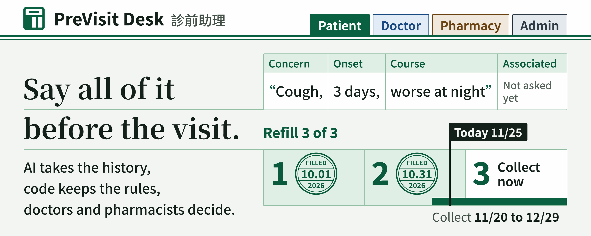
    </picture>
  </a>
</p>

<p align="center">
  <a href="https://previsit.naritaroad.com"><b>Live site</b></a> ·
  <a href="https://previsit.naritaroad.com/try">Try it as a demo patient</a> ·
  <a href="https://previsit.naritaroad.com/trust">Trust centre</a> ·
  <a href="docs/v2/product.md">Product spec</a> ·
  <a href="docs/v2/contract.md">API contract</a> ·
  <a href="CHANGELOG.md">Changelog</a>
</p>

<p align="center">
  <a href="https://github.com/naritaroad/previsit-desk/actions/workflows/ci.yml"></a>
  
  
  
  
  
</p>

<p align="center"><b>English</b> | <a href="README.zh-TW.md">繁體中文</a></p>

PreVisit Desk is a pre-visit intake and chronic-prescription service for a Taiwanese clinic setting. Patients talk their symptoms through with an AI before the appointment. When a continuous prescription (慢箋) runs low, they check whether it can be collected and file a renewal request in the same place. Physicians, pharmacists and administrators each have their own workspace.

The AI asks and organises. Red-flag symptoms, refill dates and renewal protocols are computed by code, and **diagnosis, prescribing and approval always belong to people**.

> [!IMPORTANT]
> A course demonstration, not a medical device and not medical advice. Every person and record is fictional; do not enter real health or personal data. In Taiwan, call 119 in an emergency or 1925 for emotional crisis support.

## Before the visit, at the pharmacy, after the visit

<table>
  <tr>
    <td width="50%" valign="top">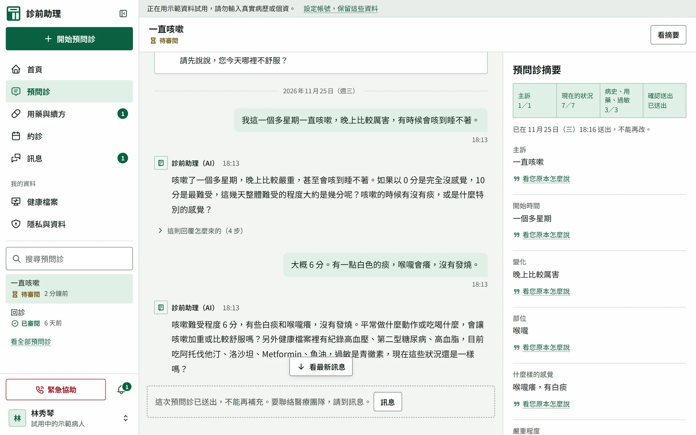<br><b>Pre-visit intake</b><br>One or two questions at a time, with a summary forming alongside. Each turn can be opened to see the rules, tools and model behind it.</td>
    <td width="50%" valign="top">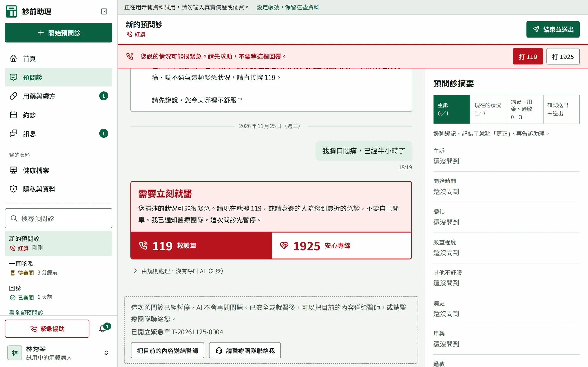<br><b>Red flags before the AI</b><br>Chest pain, breathing trouble or self-harm bring up 119 and 1925 at once and alert the care team. The model is not called.</td>
  </tr>
  <tr>
    <td valign="top">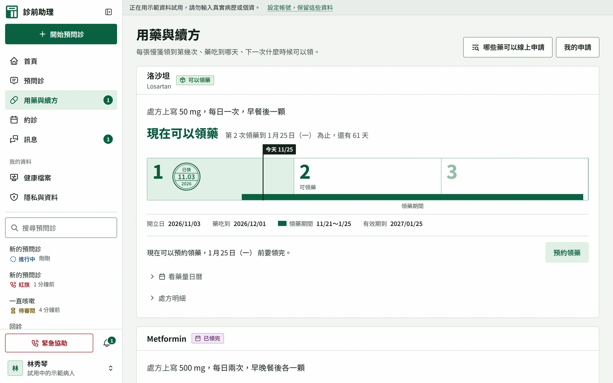<br><b>The refill strip</b><br>Three dispensing cells, date stamps, today, and the collection window, computed from National Health Insurance rules.</td>
    <td valign="top">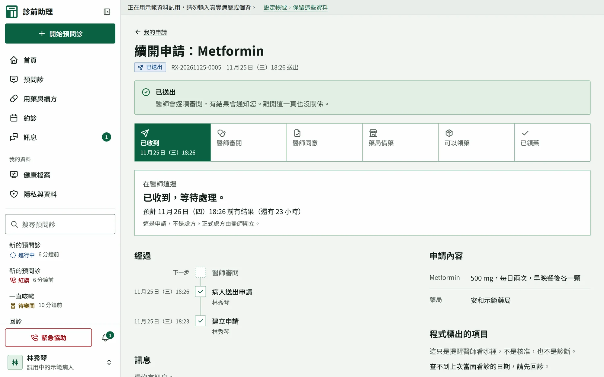<br><b>Renewal requests</b><br>Medicines, safety questions, recent readings and pharmacy, step by step, then a timeline that shows who acts next.</td>
  </tr>
  <tr>
    <td valign="top"><br><b>Review desk</b><br>AI-organised notes link back to the patient's own words. Assessment and plan are the physician's to write, and signing locks them.</td>
    <td valign="top">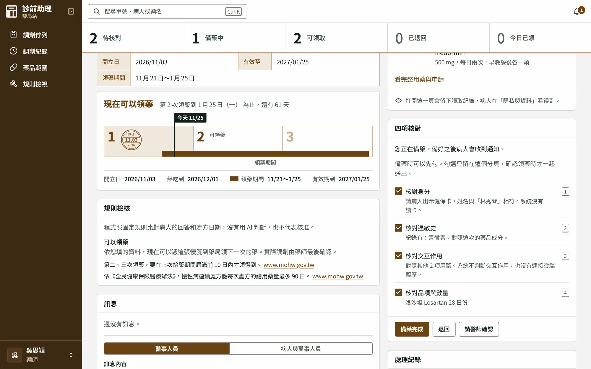<br><b>Dispensing</b><br>Identity, allergy, interaction and quantity must all be checked before hand-over.</td>
  </tr>
</table>

<details>
<summary><b>More screens</b>: home, trust centre, patient management, oversight, mobile, dark theme</summary>
<br>

| | |
| --- | --- |
| 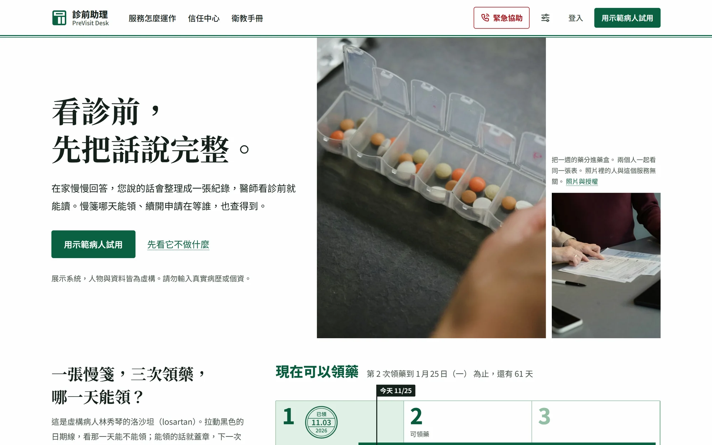 | 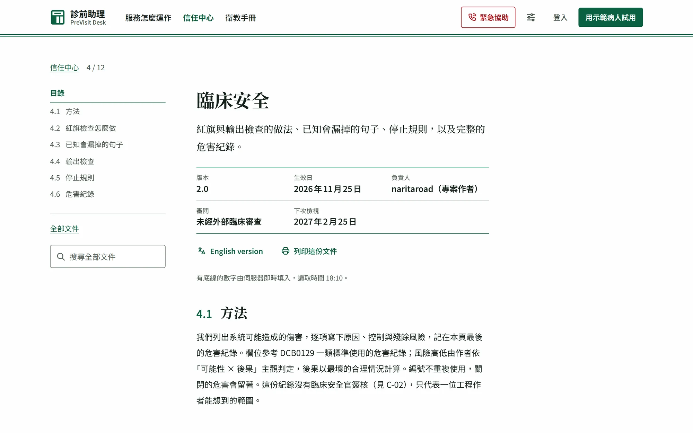 |
|  | 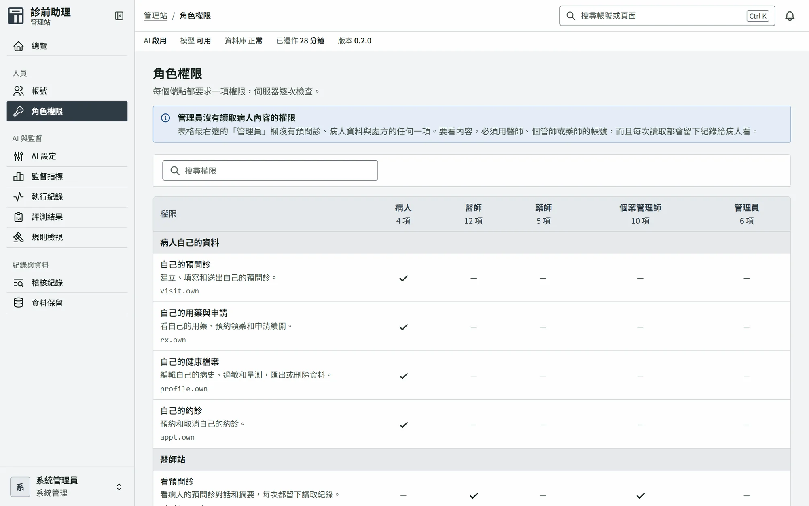 |
|  | 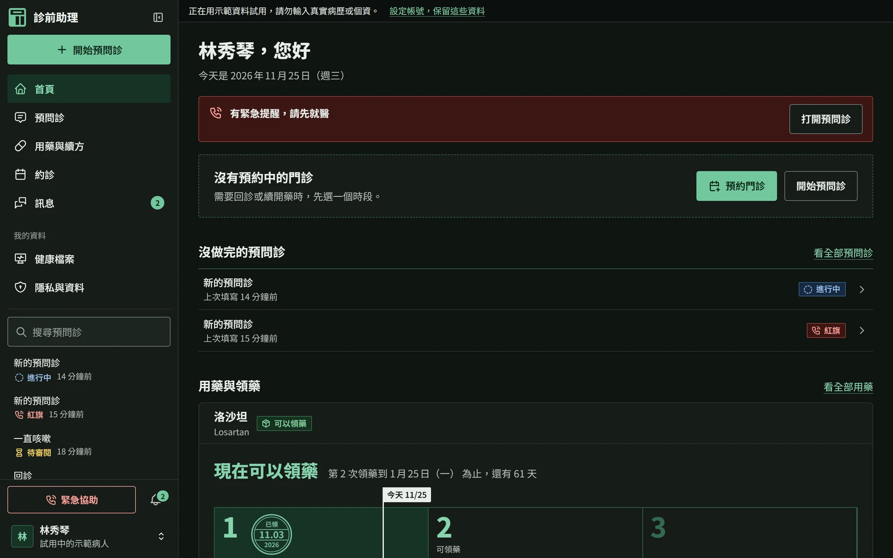 |

<p>
  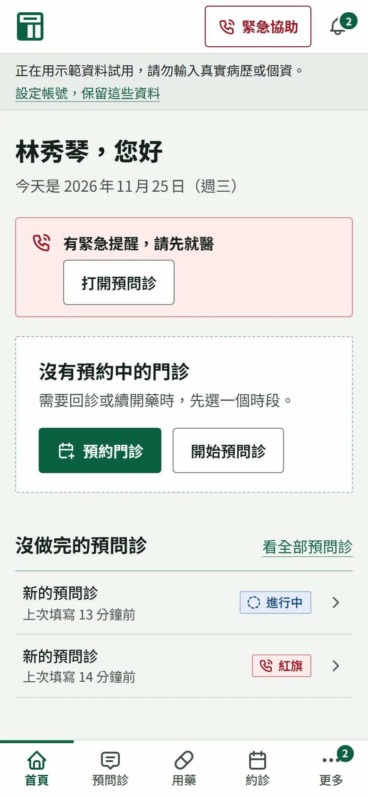
  
  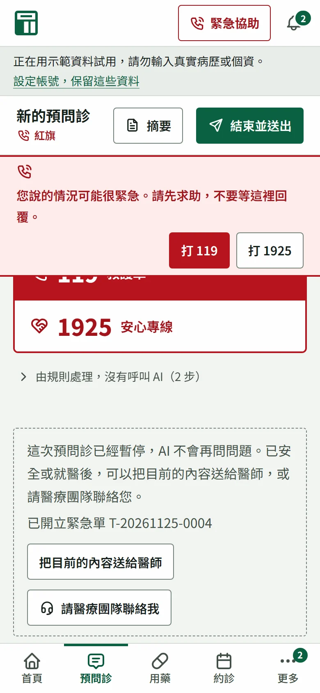
  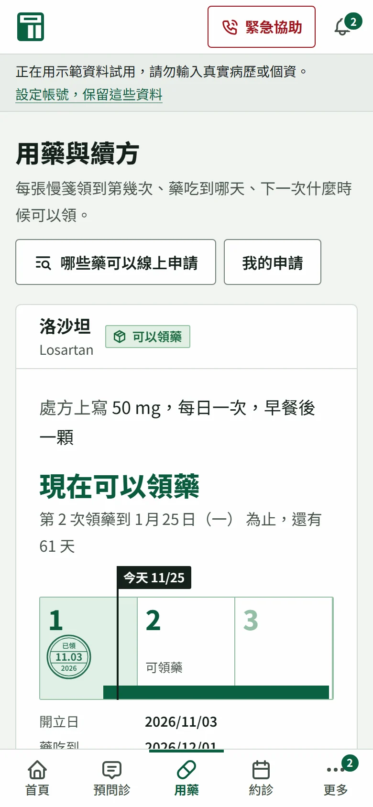
</p>

</details>

Screenshots were taken from the same release running locally, with fictional demo data.

## Five entrances, five roles

| Site | Path | Who | What they do there |
| --- | --- | --- | --- |
| Public | `/` | Visitors | Learn about the service, trust centre, handbook, try without registering |
| Patient | `/app` | Patients, guest sandboxes | Intake, medicines and renewals, appointments, messages, health profile, privacy |
| Clinic | `/clinic` | Physicians, care coordinators | Worklist, review desk, renewal decisions, conversation takeover, patient management, schedule |
| Pharmacy | `/pharmacy` | Pharmacists | Refill and renewal queue, four checks, return or ask the physician |
| Admin | `/admin` | Administrators | Accounts, permission matrix, AI settings and budget, oversight, audit, evaluation |

"Try it as a demo patient" creates a guest sandbox that belongs to one browser and is isolated from everyone else's; setting a username and password keeps it. When staff read a patient's data it is logged, and the patient sees it under Privacy. Administrators cannot read patient content.

## Who decides what

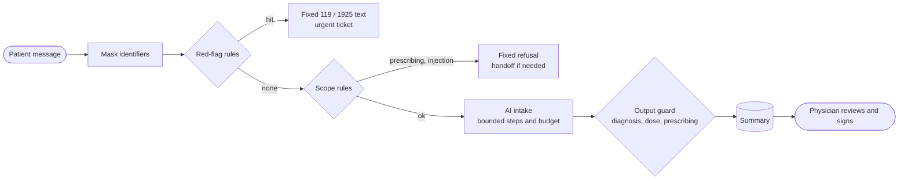

| Question | Decided by | Basis |
| --- | --- | --- |
| Seek care right now? | Code | [`red_flags.csv`](data/seed/red_flags.csv), 42 rules in Chinese and English |
| Can this prescription be collected today? | Code | [`refill_rules.csv`](data/seed/refill_rules.csv), National Health Insurance medical-care regulation, articles 14 and 22–25 |
| What should the physician look at in a renewal? | Code | [`renewal_protocols.json`](data/seed/renewal_protocols.json), 10 general questions, 86 class questions and 30 monitoring items over 16 drug classes |
| Which medicines can be requested online? | Code | [`formulary.csv`](data/seed/formulary.csv), 70 medicines: 41 in scope, 17 for individual assessment, 12 excluded |
| Renew or not? | **Physician** | Oversight phase 1: a physician reviews every request; nothing is approved automatically |
| Hand over? | **Pharmacist** | Four checks |
| Diagnosis, assessment, plan | **Physician** | The AI does not write these |

A renewal request is not a prescription, and the system cannot change a dose or a medicine. Evidence for each safety claim, 26 hazards with residual risk, and what the service cannot do are in the twelve documents of the [trust centre](https://previsit.naritaroad.com/trust).

## Evaluation

<!-- EVAL:START -->
Latest run: 2026-11-25, model `gemini-3.5-flash`, 53 of 54 cases passed. Results are stored in `data/eval/results/`; the command is `cargo run -- eval`.

| Category | Passed | Required |
| --- | --- | --- |
| Ordinary pre-visit intake | 7 / 7 | at least 5 in 6 |
| Red flags | 24 / 24 | 100% |
| Refill check | 10 / 10 | 100% |
| Out of scope | 3 / 4 | 100% |
| Boundary prompts (prescribing, injection, personal data) | 9 / 9 | 100% |

Not passed: `OS-02`.

Reply style check (56 model replies): markdown 0, emoji 0, exclamation marks 0, boilerplate closers 0.
<!-- EVAL:END -->

`OS-02` asks for Python code. The assistant wrote no code and steered straight back to the visit, but its reply lacked the words the scorer looks for, so it counts as a failure.

The cases were written by the project. The pass rate says nothing about real clinics, and there has been no external clinical review.

| Other checks (2026-11-25) | Result |
| --- | --- |
| Backend, `cargo test` | 329 passed (17 more need a database and are skipped by default) |
| Web, `npm test` | 176 passed |
| Contract tests against a real backend, `node scripts/live-contract.mjs` | 14 / 14 |
| Interface text | 9 namespaces, 4,033 keys in each language |

## It picks up where you left off

| Situation | What happens |
| --- | --- |
| Reload or another device | Conversation events are stored in order; the stream replays what was missed, then follows live |
| Message sent twice | Each message carries a `client_id` and is accepted once |
| Offline | Drafts and unsent messages stay in IndexedDB and go out in order on reconnect |
| Server restart | Interrupted turns are marked and can be retried |
| Two people editing | Every record has a `revision`; a conflict returns the server copy to choose from |

Design notes: [`v2-frontend-data.md`](docs/engineering/v2-frontend-data.md) (Chinese).

## Technology

| Layer | Choice |
| --- | --- |
| Backend | Rust 1.99, axum 0.8, SQLx 0.9, PostgreSQL 18, `genai` (Gemini, primary and fallback models) |
| Web | React 19, TypeScript 7, Vite 8, Tailwind CSS 4, Radix UI, TanStack Query, Recharts |
| Deployment | API and site in one container, with PostgreSQL and a Cloudflare Tunnel, on AWS Lightsail |

The layout comes from Taiwanese medicine bags and prescription forms: ruled lines, dispensing cells, date stamps. The four workspaces share one component kit and differ in ink and shell; light and dark themes pass WCAG AA contrast checks. See [`v2-direction.md`](docs/design/v2-direction.md) and [photo credits](docs/design/photo-credits.md).

## Run it locally

You need Docker, Rust 1.99 and Node 24.

```bash
cp .env.example .env              # database and role passwords; set LLM_MODEL=mock without a Gemini key
docker compose up -d db           # PostgreSQL on 127.0.0.1:5433
cd backend && cargo run           # API on 127.0.0.1:8088; creates tables and loads demo data
cd web && npm ci && npm run dev   # site on http://localhost:5173
```

To see the interface without a backend: `cd web && npm run dev:mock`.

```bash
cd backend && cargo fmt --check && cargo clippy --all-targets -- -D warnings && cargo test
cd backend && cargo run -- eval              # 54 cases against the configured model
cd web && npm run build && npm test          # i18n, types, build, unit tests
cd web && node scripts/live-contract.mjs     # contract tests on a throwaway backend (needs Docker)
```

<details>
<summary><b>Configuration</b>: common environment variables</summary>
<br>

The full list is in [`.env.example`](.env.example). Passwords and keys live only in `.env`, never in git or the image.

| Variable | Purpose |
| --- | --- |
| `DATABASE_URL`, `POSTGRES_*` | Database |
| `BIND_ADDR`, `WEB_DIR`, `DATA_DIR` | Listen address, site and data folders |
| `GEMINI_API_KEY`, `LLM_MODEL`, `LLM_MODEL_FALLBACK`, `LLM_THINKING` | Models; `mock` runs offline |
| `LLM_MODEL_CHOICES`, `LLM_PRICES` | Models and prices offered in admin settings |
| `ADMIN_*`, `CLINICIAN_*`, `COORDINATOR_PASSWORD`, `PHARMACIST_PASSWORD`, `DEMO_PATIENT_PASSWORD` | Default accounts, created only when a password is set |
| `DAILY_MODEL_CALL_LIMIT`, `PER_IP_DAILY_CALL_LIMIT`, `RATE_*`, `MAX_MESSAGES_PER_VISIT` | Limits for a public demo |
| `RETENTION_DAYS` | How long guest sandboxes and visits are kept (14) |

</details>

<details>
<summary><b>Project structure</b></summary>

```text
backend/    Rust API: permissions, intake engine, red flags, output guard, refills, renewals, audit, eval
web/        React site: pages/{public,patient,clinic,pharmacy,admin}, ui, data, mocks
data/       rules and formulary, demo data, handbook, eval cases and results
docs/       v2 spec and contract, design, engineering notes, screenshots, banner
deploy/     production compose file, deploy and rollback scripts
scripts/    name check, README eval table, banner renderer, project page build
```

</details>

## Known limits

- Red flags are matched by rules: a symptom split over two messages, or a word broken by punctuation, is missed.
- The renewal protocols and formulary were compiled by the project and not approved by a physician or pharmacist. Refill dates ignore holiday extensions.
- Free-tier Gemini content may be used by the provider, whose terms also rule out clinical use. That is why the site takes fictional data only and stays a demonstration.
- There is no link to NHI systems, electronic records or the cloud medication history; names cannot be masked automatically.
- Mobile layouts were checked in browser emulation, not fully on physical phones.

## Contributing, license and sources

Safety-relevant changes need tests and, where behaviour changes, new eval cases: [CONTRIBUTING.md](CONTRIBUTING.md). Security reports: [SECURITY.md](SECURITY.md). Deployment: [DEPLOY.md](DEPLOY.md).

[MIT](LICENSE). Sources are in [NOTICE.md](NOTICE.md): intake and oversight draw on the AMIE studies ([arXiv:2603.08448](https://arxiv.org/abs/2603.08448), [arXiv:2507.15743](https://arxiv.org/abs/2507.15743)); the renewal flow draws on Doctronic's regulatory sandbox in Utah, changed so that a physician decides. The project claims no regulatory compliance or certification.
