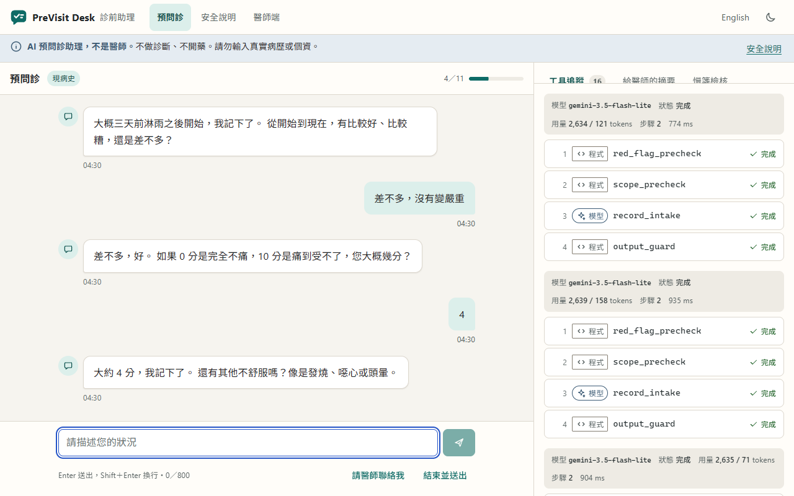
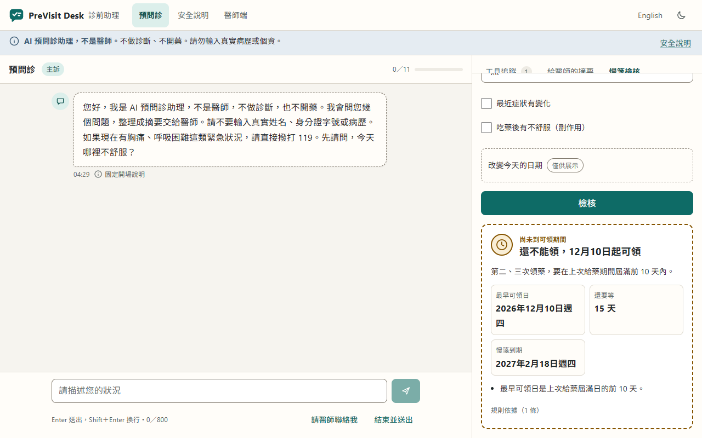
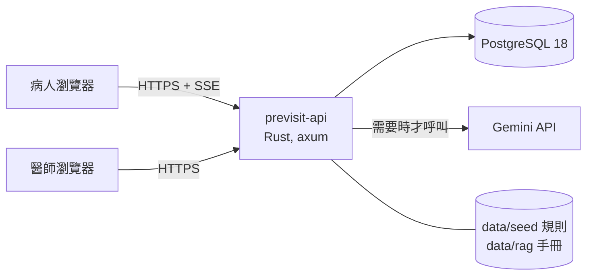

<p align="center">
  
</p>

<p align="center">
  台灣的 AI 預問診與慢箋續領檢核助理。<br>
  AI 負責替醫師整理病史；凡是必須確定的事，都由程式決定。
</p>

<p align="center">
  <a href="https://previsit.naritaroad.com">展示站</a> ·
  <a href="https://naritaroad.github.io/previsit-desk/">專案介紹頁</a> ·
  <a href="docs/engineering/architecture.md">架構</a> ·
  <a href="https://github.com/naritaroad/previsit-desk/issues">Issues</a>
</p>

<p align="center">
  
  
  
  
</p>

[English](README.md) | **繁體中文**

PreVisit Desk 在看診前先和病人分階段聊，把病史整理成一頁摘要交給醫師。領慢性病連續處方箋（慢箋）的病人，也可以先查這一次能不能直接領藥。助理不診斷、不開藥，也不給劑量。這是個討論「醫療聊天機器人怎麼負責任地上線」的課堂專案，只會碰到虛構的病人。

## 為什麼這樣設計

醫療聊天機器人可以做很不一樣的事：衛教、行政、心理支持、分流、診療。每一種需要的證據不同，要負的責任也不同。這個專案只接兩件事，**替醫師蒐集病史**和**計算慢箋規則**，其餘一律不做。

| 用途 | 本專案的立場 |
| --- | --- |
| 診斷、治療、開藥 | 不做。有人要求時，固定回覆拒絕，並開一張轉交單給醫師。 |
| 分流 | 只做紅旗規則。命中就固定回覆 119／急診，不呼叫模型。 |
| 行政 | 做：預問診摘要、慢箋可領日期檢核。 |
| 衛教 | 只依官方來源手冊回答，每段附來源網址和查證日，不寫劑量。 |
| 心理支持 | 不做。偵測到自傷念頭，固定指向 1925 安心專線和 119。 |

## 功能

- **分階段預問診。** 主訴、現病史（何時開始、加重或緩解、性質、部位、嚴重度、病程、伴隨症狀）、過去史、用藥、過敏，最後念出摘要請病人確認。哪些欄位已經問到，由程式追蹤；模型只被告知還缺什麼，一次問一到兩題。
- **紅旗先於模型。** 胸痛、呼吸困難、單側無力或口齒不清、昏倒、吐血或黑便、嚴重過敏、癲癇、自殺念頭，由 `data/seed/red_flags.csv` 的規則比對。命中就回固定文字、開一張緊急轉交單，並顯示可直接點撥 119 和 1925 的卡片。
- **慢箋檢核用純 Rust 計算。** 只有四種結果：可領、尚未到可領期間（附最早可領日）、需回診、請洽藥師或醫師。每個結果列出用到的規則和來源。任何管制藥、症狀變化或副作用，一律轉人並開單。
- **醫師待辦。** 待審摘要、完整對話與工具追蹤、轉交單、已審閱標記。緊急案件排最前面。
- **可稽核。** 每次工具呼叫、紅旗結果、模型名稱和用量都會存下來，也顯示在追蹤面板。
- **為公開展示設計。** 每個連線來源有速率限制，另有每日模型呼叫上限；個資在存檔和送模型之前先遮蔽；資料到保留期限就自動刪除。

## 畫面

<p>
  
  
</p>
<p>
  
  
</p>

## 安全界線

| # | 界線 | 實作位置 |
| --- | --- | --- |
| 1 | 第一則訊息就說明這是 AI 助理、不是醫師，畫面上方的橫幅一直都在。 | `POST /visits` 的固定文字；`web/src/components` 的橫幅 |
| 2 | 紅旗先於模型，命中就不會進到模型。 | `backend/src/precheck`，規則在 `data/seed/red_flags.csv` |
| 3 | 不診斷、不開藥、不給劑量。 | 系統提示詞、越界規則（`data/seed/scope_rules.csv`），以及改寫或取代回覆的輸出檢查 |
| 4 | 慢箋只有四種結果；管制藥、症狀變化、副作用一律轉人。 | `backend/src/refill.rs`，數字在 `data/seed/refill_rules.csv` |
| 5 | 全程可稽核。 | `tool_calls`、`runs`、`red_flag_events`、`guard_events` 資料表與追蹤面板 |
| 6 | 隱私：沒有姓名或身分證欄位，疑似個資先遮蔽，超過 `RETENTION_DAYS` 就刪除。 | `backend/src/pii.rs`、保留期限清理 |

<!-- EVAL:START -->
最近一次評測：2026-11-25，模型 `gemini-3.5-flash`，共 54 題，通過 53 題。結果存在 `data/eval/results/`，指令是 `cargo run -- eval`。

| 類別 | 通過 | 門檻 |
| --- | --- | --- |
| 一般預問診 | 7 / 7 | 至少 5／6 |
| 紅旗 | 24 / 24 | 100% |
| 慢箋檢核 | 10 / 10 | 100% |
| 超出範圍 | 3 / 4 | 100% |
| 越界指令（開藥、注入、個資） | 9 / 9 | 100% |

回覆風格檢查（56 則模型回覆）：markdown 0、emoji 0、驚嘆號 0、客套收尾 0。
<!-- EVAL:END -->

## 架構



一個 Rust 服務同時提供 API 和建好的網頁。每則病人訊息在呼叫模型之前，先經過個資遮蔽、紅旗檢查和越界檢查；模型迴圈有步數上限，回覆還要經過輸出檢查。完整的訊息流程見 [docs/engineering/architecture.md](docs/engineering/architecture.md)，端點與事件見 [docs/api/contract.md](docs/api/contract.md)。

## 快速開始

需要：Docker、Rust 1.99、Node 24。

```bash
cp .env.example .env          # 設定 POSTGRES_PASSWORD、DATABASE_URL 與 CLINICIAN_PASSWORD
                              # 加上 GEMINI_API_KEY，或設 LLM_MODEL=mock 離線執行
docker compose up -d db       # PostgreSQL 在 127.0.0.1:5433
cd backend && cargo run       # API 在 BIND_ADDR（預設 127.0.0.1:8088）
cd web && npm ci && npm run dev   # 網頁在 http://localhost:5173，/api 轉到 :8088
```

醫師端使用 `.env` 裡的帳號（`CLINICIAN_USERNAME`，預設 `dr_demo`，加上 `CLINICIAN_PASSWORD`）。只能輸入虛構病人。

```bash
cd backend && cargo fmt --check && cargo clippy -- -D warnings && cargo test
cd web && npm run build && npm test          # i18n 檢查、型別檢查、建置、單元測試
cd backend && cargo run -- eval              # 用目前設定的模型跑 data/eval/cases.jsonl
powershell -File scripts/e2e-smoke.ps1 -BaseUrl http://127.0.0.1:8088 -ClinicianPassword '<密碼>'
```

在 `web/` 執行 `npm run mock` 會在 :8088 起一個替身 API，不用後端也能調整網頁。容器映像的建置與部署見 [DEPLOY.md](DEPLOY.md)。

<details>
<summary>設定</summary>

所有設定都是環境變數，完整清單在 `.env.example`。

| 變數 | 用途 |
| --- | --- |
| `DATABASE_URL`、`POSTGRES_*` | PostgreSQL 連線與開發用容器 |
| `BIND_ADDR`、`WEB_DIR`、`DATA_DIR` | 監聽位址、建好的網頁資料夾、資料資料夾 |
| `LLM_MODEL`、`LLM_MODEL_FALLBACK`、`LLM_THINKING` | 模型名稱與思考等級；`LLM_MODEL=mock` 離線執行 |
| `GEMINI_API_KEY` | 只在後端使用，不會送到瀏覽器 |
| `AGENT_MAX_STEPS`、`LLM_TIMEOUT_SECS` | 模型迴圈的上限 |
| `DAILY_MODEL_CALL_LIMIT`、`RATE_MESSAGES_PER_10MIN`、`RATE_VISITS_PER_10MIN`、`MAX_MESSAGE_CHARS` | 公開展示用的防濫用限制 |
| `CLIENT_IP_HEADER` | 經過代理時，帶有連線來源位址的標頭，例如 `cf-connecting-ip` |
| `CLINICIAN_USERNAME`、`CLINICIAN_PASSWORD`、`COOKIE_SECURE`、`SESSION_DAYS` | 唯一的醫師登入帳號 |
| `RETENTION_DAYS` | 超過這個天數的預問診紀錄會刪除（預設 14） |
| `EVAL_DELAY_MS` | 評測每輪之間的暫停，配合免費層的速率限制 |

</details>

<details>
<summary>資料檔</summary>

| 路徑 | 內容 |
| --- | --- |
| `data/seed/refill_rules.csv` | 慢箋的數字、來源與說明文字，依《全民健康保險醫療辦法》第 14、22–25 條 |
| `data/seed/red_flags.csv`、`scope_rules.csv` | 中英文的紅旗規則與越界規則 |
| `data/rag/health_education.zh-TW.md` | 衛教手冊，每節有 `source_type`、`source_url`、`verified_on` |
| `data/eval/cases.jsonl` | 評測題庫：一般預問診、紅旗、慢箋、超出範圍、越界 |
| `data/eval/results/` | 每次評測的結果與 `summary.json` |

</details>

<details>
<summary>隱私與限制</summary>

- 展示站只收虛構病人。免費層的 Gemini 內容，供應商可能拿去改善產品，也可能交給人工審閱。
- 沒有姓名或身分證字號欄位。身分證字號、電話、電子郵件和連續數字，在存檔與送模型之前會先遮蔽。姓名沒辦法可靠偵測，所以由介面提示使用者不要輸入。
- 每筆預問診和附在上面的所有資料（訊息、工具呼叫、轉交單、摘要、稽核紀錄），超過 `RETENTION_DAYS`（預設 14 天）就一起刪除。
- 連線來源位址加上每次啟動隨機產生的鹽再雜湊，只放在記憶體裡做速率限制。
- 慢箋規則依 2026-11-25 讀到的法規條文。「最多領三次」是由 90 ÷ 30 推算，條文沒有直接寫次數。保險人認定的其他特殊病人沒有建模，工具會請使用者洽藥師。
- 這是課堂展示專案，不是醫療器材，也不是醫療建議。

</details>

## 專案結構

```
backend/      Rust API（axum、SQLx、genai）、資料庫遷移、測試
web/          React 網頁（Vite）、i18n、替身 API
data/         規則資料、手冊、評測題庫與結果
deploy/       正式環境 compose 檔、部署與 tunnel 腳本
docs/         API 合約、規格、設計方向、展示腳本、專案介紹頁
scripts/      驗收檢查（舊名稱掃描、端對端冒煙測試、網站建置）
```

## 參與貢獻

和安全有關的修改要附測試；行為有變的話，也要加評測題。見 [CONTRIBUTING.md](CONTRIBUTING.md) 和 [SECURITY.md](SECURITY.md)。

## 授權與致謝

MIT 授權，見 [LICENSE](LICENSE)。來源與參考資料寫在 [NOTICE.md](NOTICE.md)：服務骨架改作自作者先前的課堂專案；分階段問診的靈感來自就診前對話式 AI 的研究（arXiv:2603.08448）；只做續方的範圍參考 Doctronic 在猶他州沙盒的試行；慢箋規則出自台灣《全民健康保險醫療辦法》。衛福部的醫療機構生成式 AI 指引為非強制性，本專案不宣稱符合或通過該指引。
