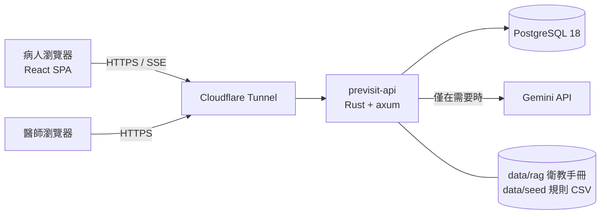
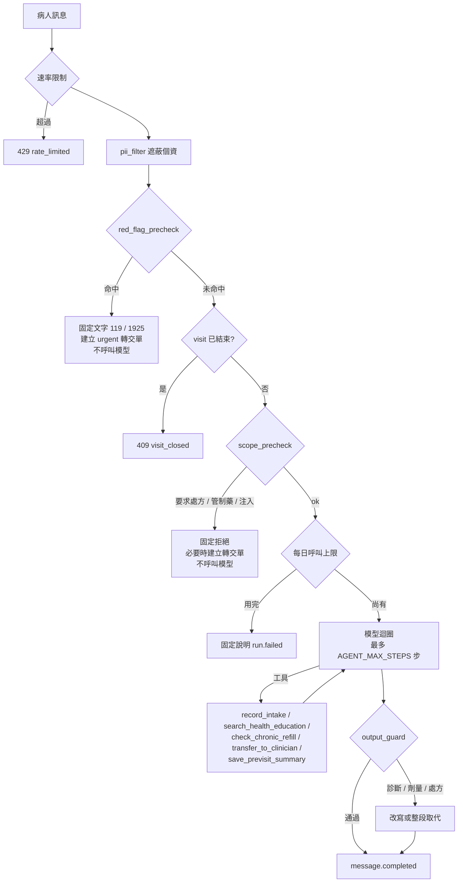
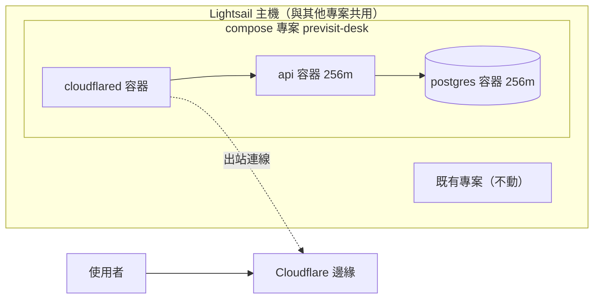

# 架構

PreVisit Desk 是一個單一 Rust 程序（axum）加 PostgreSQL；前端是 Vite 建出的靜態檔，由同一個程序提供。模型只有一個外部依賴（Gemini API），金鑰只在後端。

## 一則病人訊息怎麼走

程式先、模型後。每一步都寫進追蹤面板與資料庫（`tool_calls`）。

## 六道安全界線對應的程式位置

| # | 界線 | 實作 |
|---|---|---|
| 1 | 開場揭露「我是 AI 預問診助理，不是醫師」 | `POST /visits` 建立第一則固定訊息（`texts.rs`），前端同時顯示橫幅 |
| 2 | 紅旗先於模型 | `precheck/` + `data/seed/red_flags.csv`；命中直接回固定文字，不進模型迴圈 |
| 3 | 不診斷、不開藥、不給劑量 | 系統提示詞 + `scope_precheck`（要求處方／管制藥／注入）+ `guard.rs`（輸出後檢查，改寫或取代）|
| 4 | 慢箋只回四種結果；管制藥、症狀變化、副作用一律轉人 | `refill.rs` 純函式；規則數字在 `data/seed/refill_rules.csv`；`consult` 一律建轉交單 |
| 5 | 可稽核 | `tool_calls`、`runs`（含模型名稱與用量）、`red_flag_events`、`guard_events`；追蹤面板直接顯示 |
| 6 | 隱私 | 無姓名欄位；`pii_filter` 在存檔與送模型前遮蔽身分證號、電話、電子郵件；依 `RETENTION_DAYS` 刪除整筆 visit |

## 問診狀態

`visits.intake`（jsonb）保存 `IntakeState`。階段由程式依欄位算出（`chief_complaint → hpi → background → confirm → done`）；每回合把「已取得」與「尚缺」放進系統提示詞，模型只問缺的。模型用內部工具 `record_intake` 寫欄位，程式驗證後合併；摘要由 `save_previsit_summary`（模型）或 `POST /visits/{id}/submit`（程式）產生。

## 資料

| 路徑 | 內容 | 單一來源 |
|---|---|---|
| `data/seed/refill_rules.csv` | 慢箋數字與來源 | 日數、窗口天數、次數 |
| `data/seed/red_flags.csv` | 紅旗規則（regex，中英）| 紅旗判斷 |
| `data/seed/scope_rules.csv` | 越界規則 | 範圍判斷 |
| `data/rag/health_education.zh-TW.md` | 衛教手冊，每節附 `source_type`、來源網址、查證日 | 衛教文字 |
| `data/eval/cases.jsonl` | 評測題庫 | 評測 |
| `data/eval/results/` | 評測結果（含 `summary.json`）| 通過率 |

## 部署拓撲

主機不開任何對外連接埠（SSH 除外）；流量由 cloudflared 容器以出站連線接入。映像在本機建置（linux/amd64），以 `docker save | ssh … docker load` 傳到主機。細節見 [DEPLOY.md](../../DEPLOY.md)。
