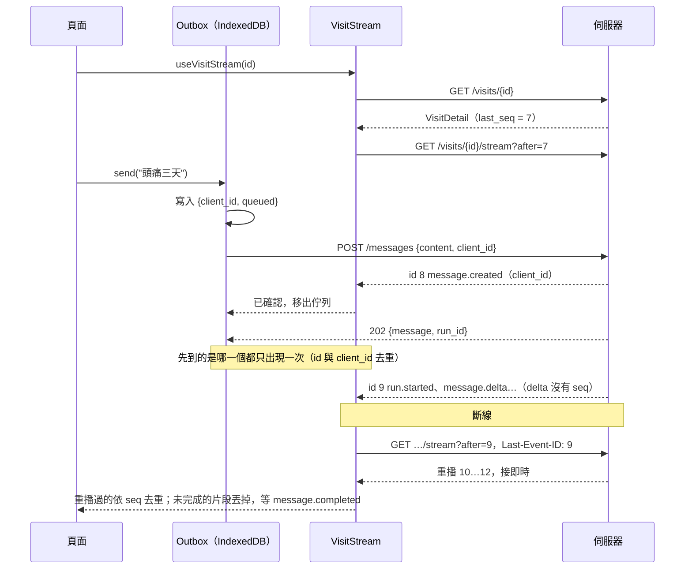

# v2 前端資料層

2026-11-25。範圍：`web/src/api`、`web/src/data`、`web/src/lib`、`web/src/i18n/index.ts`、`web/src/mocks`、`web/tests`。HTTP 形狀以 `docs/v2/contract.md` 為準，狀態持久化的需求見 `docs/v2/product.md` §8。

## 1. 分層

| 資料夾 | 內容 | 頁面可以直接用嗎 |
|---|---|---|
| `api/types.ts` | 合約的全部型別 | 可以（型別） |
| `api/client.ts`、`endpoints.ts`、`sse.ts`、`errors.ts` | fetch、每個端點一個函式、SSE、`ApiError` | 不要；用 `data` 的 hook |
| `api/schemas.ts` | 表單輸入的 zod，訊息是 `errors:field.*` 的鍵 | 可以 |
| `data/core/*` | 不依賴 React 的控制器（草稿、送出佇列、串流、精靈…） | 不要；用 `data/live.ts` 的 hook |
| `data/*.ts` | 各領域的 hook，全部由 `@/data` 匯出 | 可以 |
| `lib/*` | 純函式：日期、權限、連結、狀態標籤、追蹤分組、reducer | 可以 |
| `mocks/*` | 模擬伺服器，只在 `--mode mock` 載入 | 不要 |

`main.tsx` 最外層放 `<DataProvider>`，其他都靠 hook。

## 2. Hook 一覽

查詢回傳 TanStack Query 的結果；清單另有 `items`、`total`、`hasNextPage`、`fetchNextPage`。寫入是 mutation，標「樂觀」的會先改畫面，失敗時還原。

### 登入與帳號（`auth.ts`、`account.ts`）

| Hook | 回傳與說明 |
|---|---|
| `useAuth()` | `{status, me, expired, error, isSignedIn, mustChangePassword, home, can(...), canAny(...), refresh(), logout()}`。`status`：`loading`、`anonymous`、`authenticated`、`offline`（顯示上一個帳號的快取）、`unreachable` |
| `useMe()`、`useCan('rx.decide')` | 目前帳號、是否有權限 |
| `useLogin()`、`useGuest()`、`useRegister()`、`useClaim()`、`useChangePassword()` | 成功後自動切換帳號與快取。`useGuest`、`useRegister` 要帶 `adult: true` |
| `useUpdateMe()`、`useSessions()`、`useRevokeSession()`（樂觀）、`useExport()`、`useDeleteAccount()`、`usePersonas()` | |
| `useNotifications({unread?, limit?})`、`useUnreadCount()`、`useMarkRead()`（樂觀） | `mutate(undefined)`＝全部已讀 |
| `useAccountStream({onNotification, onEvent})` | 查詢失效已自動處理；這裡只放 toast。`onNotification` 只在看得到的分頁呼叫 |
| `usePreferences()` | `{prefs:{theme,text,density,sidebar}, setPrefs(part)}`，立刻套用，背景同步 |
| `useSavedFilter('worklist', {bucket:'pending', q:''})` | `[value, set(part), reset()]`，跟著帳號走 |

`mustChangePassword` 為 true 時，API 除了改密碼以外都回 403，所以串流和送出佇列會等改完密碼才啟動。

### 預問診（`visits.ts`、`live.ts`）

| Hook | 說明 |
|---|---|
| `useVisits({status?, archived?, q?})`、`useVisitDetail(id)` | |
| `useCreateVisit()`、`useUpdateVisit()`（樂觀）、`useDeleteVisit()`（樂觀） | |
| `useVisitStream(id)` | 即時的 visit，見 §3.1 |
| `useOutbox(id, 'patient' \| 'staff')` | 送出佇列，見 §3.2 |
| `usePatchSummary(id)`（樂觀）、`staleSummary(error)` | 409 時取得新版摘要 |
| `useSubmitVisit`、`useHandoff`、`useRefillCheck` | |
| `useAssignVisit()`（樂觀）、`useTakeover(id)` → `{takeover, release}` | |
| `useNoteEditor(id)` | 審閱台：草稿、存檔、簽署、補記、衝突，見 §3.5 |

```tsx
const visit = useVisitStream(id);
const outbox = useOutbox(id);
const draft = useDraft(`visit:${id}:composer`, "");
async function send() {
  await outbox.send(draft.value); // 已寫進 IndexedDB 才會 resolve
  await draft.clear();
}
// 對話＝visit.messages ＋ outbox.items（queued、sending、failed）＋ visit.live?.text
```

### 病人（`patient.ts`）

`usePatientHome`、`useProfile`、`useSaveProfile`＋`staleProfile(e)`、`useMeasurements(kind?)`、`useAddMeasurement`（樂觀）、`useDeleteMeasurement`（樂觀）、`useMedications`、`useAddMedication`、`useAppointments`、`useSlots(params)`、`useBookAppointment`、`useCancelAppointment`（樂觀）、`useAccessLog`、`useConsents`、`useConsentState`＋`consentStatus(state, doc)`、`useSetConsent`（樂觀）。

### 申請（`rx.ts`、`live.ts`）

| Hook | 說明 |
|---|---|
| `useRxList({status?, kind?})`、`useRx(id)`、`useCreateRx()`、`useCancelRx()`、`useReplyRx(id)`、`useRxMessage(id)`（樂觀） | |
| `useRxWizard(id)` | 精靈，見 §3.4 |
| `useRxQueue(bucket?, q?)` → `{items, counts}`、`useAssignRx()`（樂觀）、`useDecideRx(id)` | |
| `usePharmacyAction(id)`、`allChecked(checks)`、`needsNote(action)` | |
| `useProtocols()`、`useFormulary({scope?, q?})` | 公開資料 |
| `staleRx(e)`、`refillRefusal(e)` | 409 的新版申請；422 的慢箋檢核結果 |

按鈕一律看 `allows(rx, 'submit')`（`allowed_actions`），不要從狀態推。

### 診所、管理、公開

- `clinic.ts`：`useClinicOverview`、`useWorklist`、`useTickets`、`useResolveTicket`、`useSchedule(date)`、`useStaff(roles?)`、`usePatients`、`usePatient(id)`、`useUpdatePatient(id)`、`usePatientNotes(id)` → `{add, update, remove}`、`useContactPatient(id)`。
- `admin.ts`：`useAdminOverview(days)`、`useAccounts`、`useAccount`、`useCreateAccount`、`useUpdateAccount`、`useResetPassword`、`useRevokeAccountSessions`、`usePermissionMatrix`、`useSettings`、`useSaveSettings`＋`staleSettings(e)`、`useModels`、`useOversight`、`useRuns`、`useRun`、`useAudit`、`useRules`、`useAdminEval`、`useResetDemo`。一次性密碼在 mutation 的 `data` 裡，看完呼叫 `reset()`。
- `public.ts`：`useMeta`、`useToday`、`useHealth`、`useTrustFacts`、`usePharmacies`、`useHandbook`、`useHandbookSearch(q)`。

### 常用純函式

- 錯誤：`describeError(e)` → `{key, params, retryable}`，直接 `t(d.key, d.params)`；`fieldMessage(t, message)`；`applyFieldErrors(e, names, setError)`（回傳沒有對應欄位的訊息）。
- 格式：`formatDate`、`formatDateTime`、`formatRelative`、`formatSpan`、`formatUsd`…，一律以台北時間顯示。
- 標籤：`rxStatusMeta`、`dispositionMeta`、`outcomeMeta`、`scopeMeta`、`medicationMeta`、`refillMeta`、`urgencyMeta`、`visitStatusMeta` → `{labelKey, hintKey, tone}`，文字在 `rx` 命名空間。
- 連結：`paths.*`、`visitPath(role, id)`、`rxPath(role, id)`、`internalLink(link)`（伺服器給的連結都要先過這個）、`safeNext(next, fallback)`。

## 3. 狀態持久化

IndexedDB 資料庫 `previsit-desk`，鍵都帶帳號 id：`pv:draft:<帳號>:<scope>`、`pv:outbox:<帳號>`、`pv:rx:<帳號>:<申請>`、`pv:cache:<帳號>`。IndexedDB 不能用時退回記憶體，這時未送出的內容只在這個分頁。

| 事件 | 查詢快取 | 草稿、送出佇列、精靈 |
|---|---|---|
| 重整、關分頁 | 保留（24 小時內、同一版建置） | 保留 |
| 登入過期（401） | 刪除 | 保留，同一帳號登入後繼續送 |
| 登出 | 刪除 | 刪除 |
| 換帳號登入 | 刪除上一個帳號的全部 | 刪除上一個帳號的全部 |
| 角色改變 | 刪除 | 保留 |

快取不含 `admin`、`public`、`sessions`，也不含標了 `meta: {persist: false}` 的查詢。只有在伺服器確認身分之後（或離線時，對這個瀏覽器的上一個帳號）才會還原。

### 3.1 即時對話



- 重連間隔 0.5、1、2、4… 秒，上限 15 秒，收到事件就歸零；429 依 `Retry-After`。
- 40 秒沒有任何位元組（伺服器每 15 秒送 keep-alive）視為斷線。
- 分頁隱藏超過 10 秒暫停，回來馬上續接。離線時停止，上線時續接。
- 401、403、404 不再重試，`phase` 變 `error`。
- `visit.run.phase`：`idle`、`running`、`failed`、`interrupted`；後兩者 `canRetry` 為 true，呼叫 `retryRun()`。
- 緊急卡片看 `visit.redFlag`，不要看狀態。

### 3.2 送出佇列

訊息先寫進 IndexedDB 才送。狀態：`queued`、`sending`、`sent`、`failed`。

- 同一個 visit 依序送；一則 `failed` 會擋住後面的，直到重試或收回（`discard` 會把文字還給輸入框）。
- 上一個分頁送到一半關閉，接手的分頁用同一個 `client_id` 再送；伺服器對重複的 `client_id` 回同一則，所以不會變兩則。
- 回合進行中不送；伺服器回沒有 `current` 的 409（忙碌）時 1.5 秒後再試，不當成錯誤。
- 多分頁用 Web Locks 選一個分頁送（沒有 Web Locks 時用 localStorage 租約），其他分頁用 BroadcastChannel 看到同樣的狀態。

### 3.3 草稿 `useDraft(scope, initial)`

`status`：`idle`、`saving`、`saved`、`offline`、`conflict`。

1. 每次改動立刻寫 IndexedDB，停 0.8 秒後 PUT（連續輸入時最多 5 秒一次），帶 `revision`。
2. 開啟時先顯示本機版，再讀伺服器：本機沒有未存的改動就採用伺服器版；有的話比對 `revision`。
3. 409：`conflict = {mine, theirs}`，`theirs` 為 null 表示另一台裝置已刪除。在 `resolve('mine' | 'theirs' | {merged})` 之前不會再送。
4. 分頁隱藏或關閉時用 `fetch keepalive` 送出；來不及送的留在本機，下次開啟補送。
5. 用掉之後呼叫 `clear()`，各分頁與伺服器一起清。

### 3.4 精靈 `useRxWizard(id)`

伺服器的申請（`draft`、`more_info`）是唯一來源，未存的改動疊在上面。`wizard.goTo`、`setAnswer`、`setMonitoring`、`setPharmacy`、`setPickupWindow` 都會自動存；`wizard.missing(today)` 列出還缺什麼與在哪一步；`submit(consentVersion)` 會先存完再送。

兩台裝置改不同題目會自動合併；同一題答案不同時 `conflict.keys` 列出鍵，`resolve('mine' | 'theirs')` 只處理衝突的題目。步驟：續開 `items → identity → safety → monitoring → pharmacy → review`，領藥 `items → safety → pickup → review`。身分核對題是伺服器給的 `same_as_record:<item id>`，用 `identityQuestions(rx)` 取；`last_seen_days` 由伺服器計算，不要問。

### 3.5 筆記 `useNoteEditor(id)`

未存的文字走 `useDraft('note:<visit>')`，`save()` 才建立新版本，`sign()` 會先存再簽。`conflict` 表示別人存了新版，用 `resolve()` 選或合併。AI 只填 `subjective`、`objective`。

### 3.6 離開提醒

`useLeaveGuard(id, active, messageKey)` 用在真的會遺失或沒送出的內容；草稿會自己存，不用加。外框用 `useLeaveReasons()` 接 `useBlocker` 與登出確認。

## 4. 多語

`useTranslation(['patient', 'errors', 'rx'])` 會等命名空間載入（Suspense）。檔案是 `i18n/locales/<語言>/<命名空間>.json`，`common`、`errors` 一開始就載入。路由 loader 可先呼叫 `preloadNamespaces('clinic', 'rx')`。

## 5. 測試

```powershell
cd web
npx vitest run                      # 單元、持久化、mock 合約
node scripts/live-contract.mjs      # 真後端合約：自己開一個拋棄式資料庫和 API，跑完就刪
```

| 檔案 | 測什麼 |
|---|---|
| `outbox`、`draft`、`rxWizard`、`visitStream`、`persist` | §3 的每一條規則，含多分頁、離線、衝突、接手 |
| `contract.suite.ts` | 每個角色走過合約的全部端點，回應以 `shapes.ts` 的嚴格 zod 檢查，並在上面跑真正的控制器 |
| `contract.mock`、`contract.live` | 同一套分別跑在模擬伺服器與真後端 |
| `mocks` | 路由與合約文件一致、固定資料完整、規則檔只有一個來源 |
| `api`、`lib` | 客戶端、SSE、表單 schema、純函式、語言檔 |

`live-contract.mjs` 需要 Docker 與建好的 `backend/target/debug/previsit-api`。它用自己產生的密碼和自己的 PostgreSQL 容器，不讀 `.env`，不碰開發用資料庫。要對現有的後端跑，設 `API_BASE` 與後端同名的密碼環境變數；它會寫入資料。`KEEP=1` 會保留執行個體給瀏覽器檢查：

```powershell
$env:KEEP=1; node scripts/live-contract.mjs
$env:API_PROXY_TARGET='http://127.0.0.1:8098'; npx vite
```

## 6. 模擬伺服器

`npm run dev:mock`。頁面的 `fetch` 由 MSW handler 直接回應，沒有 service worker，所以網路面板看不到這些請求。資料在 localStorage，重整與多分頁共用，隔天自動重建；固定資料都以「今天」為準。題目、藥品、紅旗、慢箋規則與藥局直接讀 `data/`，不另抄一份。

帳號：`patient_demo`、`dr_demo`、`cm_demo`、`rph_demo`、`naritaroad`，密碼任意 8 個字以上（`wrong` 或 `not-` 開頭代表錯的密碼）。

| `?mock=`（可用逗號連用）或 `__mock.set('…')` | 效果 |
|---|---|
| `as:dr_demo` | 直接登入 |
| `reset` | 重建資料並登出 |
| `offline`／`online` | 斷網：請求失敗、串流中斷、`navigator.onLine` 為 false |
| `409`、`409*2` | 每一次（或接下來兩次）寫入都撞到新版本；也可用 `401`、`403`、`422`、`429`、`500` |
| `ok` | 取消上一列 |
| `latency:1500`、`slow`、`fast` | 延遲與 AI 回覆速度 |
| `drop`／`nodrop` | 串流每幾秒斷一次 |
| `empty`／`full` | 所有清單變空 |
| `log` | 在主控台列出請求 |

設定保留在這個分頁。另有 `__mock.loginAs()`、`reset()`、`drop()`、`interrupt()`（像伺服器重啟）、`notify()`、`editElsewhere('drafts' | 'rx' | 'notes' | 'profile' | 'settings')`（製造 409）。

在對話裡輸入 `/fail`、`/interrupt`、`/slow`、`/summary`、`/budget` 會得到對應的回合。

## 7. 與合約文件的差異

以下是後端實際回應、合約 §1–§7 沒寫或寫法不同的地方；型別以實際回應為準，`contract.live` 已驗證。

- `PUT /me/preferences` 回 `{me}`；`POST /rx/{id}/messages` 回整個 `RxRequest`；單一物件有的包一層（`{visit}`、`{ticket}`、`{summary}`），有的沒有，`endpoints.ts` 兩種都收。
- `GET /app/consents` 回全部歷史與 `current_versions`；`doc` 另有 `adult`。
- `GET /appointments/slots` 只列還能約的時段。`GET /pharmacies` 要登入。
- `HomeTask.due_at` 可能是日期，也可能是時間。
- `RxRequest.questions` 另含每項藥的 `same_as_record:<item id>`；領藥預約也有三題。決定的欄位錯誤以 item id 為鍵。
- 一般續開送出後是 `submitted`，指派醫師或醫師做決定才變 `in_review`；緊急的直接 `in_review`。
- `note.signed` 事件不帶筆記，前端會重讀一次 visit。
- `RxRequestBrief.pickup_window`、`pharmacy_name` 已宣告，2026-11-25 14:39 建置的後端還沒有回傳，`shapes.ts` 暫時容許缺少。
